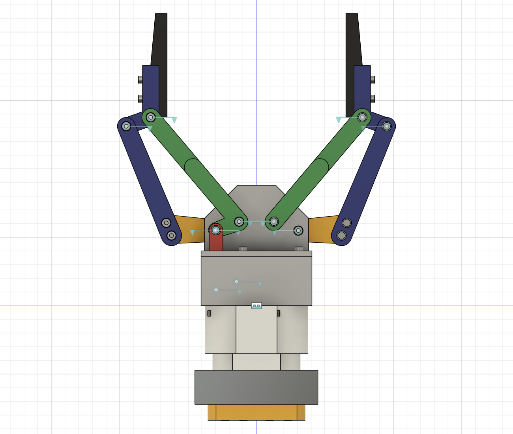
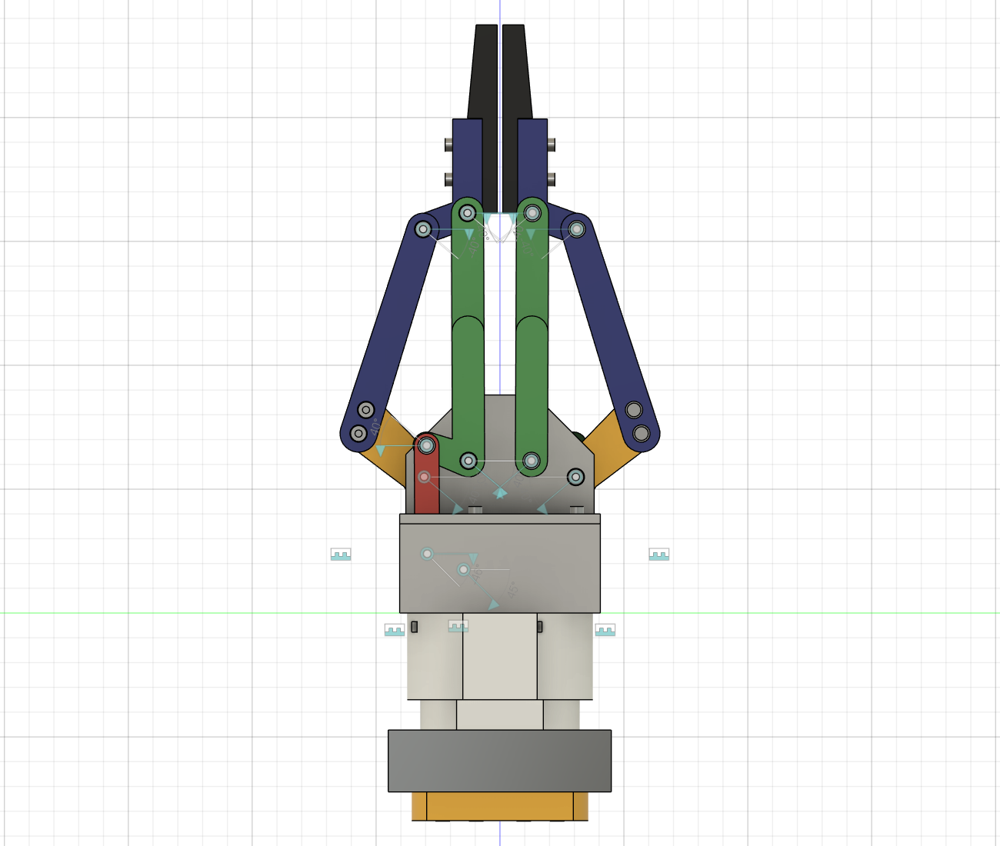

# HomeMade UR10 Gripper (HomeMade2F140)

**English version: [README.md](README.md)**

> **Nota de idioma:** el autor habla español, pero la documentación y las
> instrucciones de este repositorio están escritas en inglés. Este README, el
> manual de ensamble y la lista de compras también están en español.

Gripper de dos dedos imprimible en 3D para un UR10e. Reproduce la cinemática
de los dedos del Robotiq 2F-140 de nuestra simulación del WARA challenge y lo
mueve un solo servo PWM DFRobot SER0062 (D5545GS) de 45 kg·cm.

| Abierto | Cerrado |
|---|---|
|  |  |

## Lo más importante

- **Misma geometría de dedos que la simulación.**
  - Pivotes, eslabones de 100 mm en paralelogramo, pad y rango de
    `finger_joint` salen del URDF de Robotiq.
  - En el CAD, la punta sigue al URDF con menos de 0,001 mm de error en todo el
    recorrido.
  - La apertura es de 130,7 mm en q = 0 y de 2,0 mm en q = 0,7, igual que en la
    simulación.
- **Dedos sincronizados mecánicamente.** Dos sectores dentados en los outer
  knuckles mantienen los dedos en espejo exacto.
- **Accionamiento simple y robusto.**
  - El servo va dentro de la base y mueve el inner knuckle izquierdo con una
    manivela y una biela.
  - 45,7° de servo cubren todo el recorrido.
  - Todas las cargas del servo pasan por pernos de acero; ningún diente impreso
    recibe directamente el par del servo.
- **Topes integrados.** El perno del pivote interior corre por una ranura en
  cada engrane, así que los pads nunca chocan.
- **Verificado en Fusion.** Cero interferencias en 36 poses de todo el
  recorrido, incluida la tornillería modelada.
- **Casi todo impreso, pocos tipos de tornillo.** 17 piezas impresas,
  tornillería M3 en 5 largos y 4 tornillos M6 para la brida del robot.

## Sobre los espaciadores y el camera mount

El espaciador A, el espaciador B y el camera mount reproducen el ensamble real
de la muñeca del UR10e que usamos en la celda del WARA challenge:

- soporte para la cámara RealSense D435i;
- dos espaciadores cilíndricos;
- todo atornillado a la brida con el patrón UR (4 × M6 en un círculo de 50 mm).

Se incluyen para que el gripper impreso quede a la misma altura y orientación
que en la simulación (base del gripper a 77,2 mm de la brida). **No forman
parte del gripper como tal.**

El gripper empieza en la caja, que se atornilla al espaciador B con
4 × M3 × 12. Para usarlo en otro robot necesitas un adaptador entre tu brida y
la caja. El punto de partida natural es usar solo el espaciador B con tornillos
M6 más cortos; esto no está validado.

## Lista completa de piezas

### Piezas impresas

Los STL están en `print/parts`, ya orientados para imprimir. El sufijo `_xN` es
la cantidad.

| Cant. | Pieza | Grupo |
|---:|---|---|
| 1 | Caja (housing box) | gripper |
| 1 | Torre | gripper |
| 1 | Manivela (pieza en blanco para taladrar con el horn) | gripper |
| 1 | Biela | gripper |
| 1 | Outer knuckle L (engrane) | gripper |
| 1 | Outer knuckle R (engrane, no intercambiable con L) | gripper |
| 2 | Outer finger | gripper |
| 2 | Inner knuckle | gripper |
| 2 | Inner finger | gripper |
| 2 | Punta (fingertip) | gripper |
| 1 | Espaciador B | muñeca |
| 1 | Espaciador A | muñeca |
| 1 | Camera mount | muñeca |

Son 17 piezas: 14 del gripper y 3 de la muñeca. En `print/plates` está todo el
set en un STL y también repartido en tres placas de 250 × 250 mm. Material
recomendado: PETG, ASA o PA-CF.

### Piezas compradas

| Cant. | Artículo |
|---:|---|
| 1 | Servo DFRobot SER0062 (D5545GS) de 45 kg·cm, PWM 180°, con su horn metálico |
| 1 | Fuente regulada / BEC de 6-8,4 V para el pico de corriente del servo, más un fusible |
| 1 | RealSense D435i (solo si armas el camera mount) |

### Tornillería

Tornillos allen ISO 4762, acero 8.8 o inoxidable A2:

| Artículo | Gripper | Muñeca | Total |
|---|---:|---:|---:|
| M3 × 8 | 4 (horn, si sus agujeros son M3) | 2 (cámara) | **6** |
| M3 × 12 | 5 | 4 | **9** |
| M3 × 16 | 9 | - | **9** |
| M3 × 30 | 10 | - | **10** |
| M3 × 50 | 2 | - | **2** |
| M6 × 70 | - | 4 | **4** |
| Tuerca M3 nyloc (ISO 10511) | 26 | 4 | **30** |
| Arandela M3 (ISO 7089, 7 × 0,5 mm) | 46 | 4 | **50** |
| Pasador 6 × 12 mm (opcional) | - | 1 | **1** |

Herramientas: llaves allen de 2,5 y 5 mm, y una llave de 5,5 mm.

En `docs/BOM.md` está dónde va cada tornillo (en inglés). Las listas de compra
están en `docs/shopping_list/`, en inglés y en español.

## Cómo armarlo

1. **Imprime** las piezas de `print/parts` o las placas de `print/plates`.
   - Usa 3 o más perímetros y 25-40 % de relleno.
   - Las piezas ya vienen orientadas. Solo los agujeros horizontales de los
     pivotes podrían necesitar soporte si tu impresora no hace bien los puentes.
2. **Compra** la tornillería de la lista.
3. **Ensambla** siguiendo el manual estilo LEGO de `docs/manual/`: 26 pasos,
   cada uno con su recuadro de piezas y vistas despiezadas.
   - Español: `HomeMade2F140_Manual_de_ensamble_ES.pdf`
   - Inglés: `HomeMade2F140_Assembly_Manual_EN.pdf`
4. **Conecta y calibra** con `docs/WIRING.md` y la tabla del servo. Empieza a
   6 V con límite de corriente.

### Calibración del servo

Ángulo de la manivela respecto a su posición de montaje. Positivo cierra el
gripper.

| q de la simulación (rad) | Servo (°) | Apertura de pads (mm) |
|---:|---:|---:|
| 0,0 | 0,0 | 130,7 |
| 0,2 | 13,0 | 97,8 |
| 0,4 | 25,9 | 61,0 |
| 0,6 | 38,8 | 21,9 |
| 0,7 | 45,4 | 2,0 |

La relación es casi lineal: servo_deg ≈ 64,8 × q. Los topes mecánicos están en
−2,0° y +45,7°.

## Estructura del repositorio

```
cad/        modelo de Fusion 360 (.f3d) y STEP del ensamble completo
print/      STL orientados para imprimir: parts/ (uno por pieza), plates/ (set completo y placas 250x250)
docs/       BOM, especificación, cableado, guía de Fusion, manuales (EN/ES),
            listas de compra (EN/ES), imágenes, datos de verificación
scripts/    generador en Python de todo el diseño (geometría, Fusion, chequeos, STL, manual)
LICENSE, LICENSES/, THIRD_PARTY_NOTICES.md   licencias (ver abajo)
```

En `docs/FUSION.md` se explica cómo mover el mecanismo en Fusion: arrastra la
manivela roja, o usa *Drive Joints* en el joint `Servo_Horn`.

## Estado

- **Diseñado y verificado en CAD:** geometría, joints, chequeo de
  interferencias en todo el recorrido, orientación de impresión y manual.
- **Falta comprobar con las piezas reales:**
  - el patrón de agujeros del horn real (la manivela es una pieza en blanco);
  - la profundidad de rosca de la brida UR (mínimo 7 mm) y de la D435i;
  - las tolerancias de impresión;
  - la resistencia a largo plazo con el servo trabado a 8,4 V.

## Seguridad

Este es hardware experimental hecho en casa. El diseño no ha sido probado en
resistencia, fatiga ni seguridad.

- Un servo de 45 kg·cm puede pellizcar fuerte. Mantén dedos y cables lejos.
- Haz las primeras pruebas a 6 V con límite de corriente y con el robot quieto.
- Nunca alimentes el servo desde los 5 V de un microcontrolador.

Lo construyes y lo usas **bajo tu propio riesgo**. Revisa las exenciones de
garantía y responsabilidad de las licencias.

## Licencia

Este es hardware de código abierto.

| Qué | Licencia |
|---|---|
| Diseño de hardware y documentación: `cad/`, `print/`, `docs/`, READMEs | [CERN-OHL-P-2.0](LICENSE) (licencia de hardware abierto de CERN v2, permisiva) |
| Software: todo lo de `scripts/` | [MIT](scripts/LICENSE) |

Copyright (c) 2026 Alejandro Garcia.

Toda la geometría de las piezas es un diseño original. La cinemática de los
dedos reproduce los parámetros numéricos de la descripción ROS pública de
Robotiq (BSD-3-Clause), para que el gripper coincida con las simulaciones
existentes. No se incluye ningún archivo de Robotiq; ver
[THIRD_PARTY_NOTICES.md](THIRD_PARTY_NOTICES.md).

Robotiq, 2F-140, Universal Robots, UR10e, DFRobot, Intel RealSense, Autodesk y
Fusion son marcas de sus respectivos dueños. Se mencionan solo para describir
compatibilidad. Este proyecto es independiente y no está afiliado ni respaldado
por ninguna de esas empresas.
